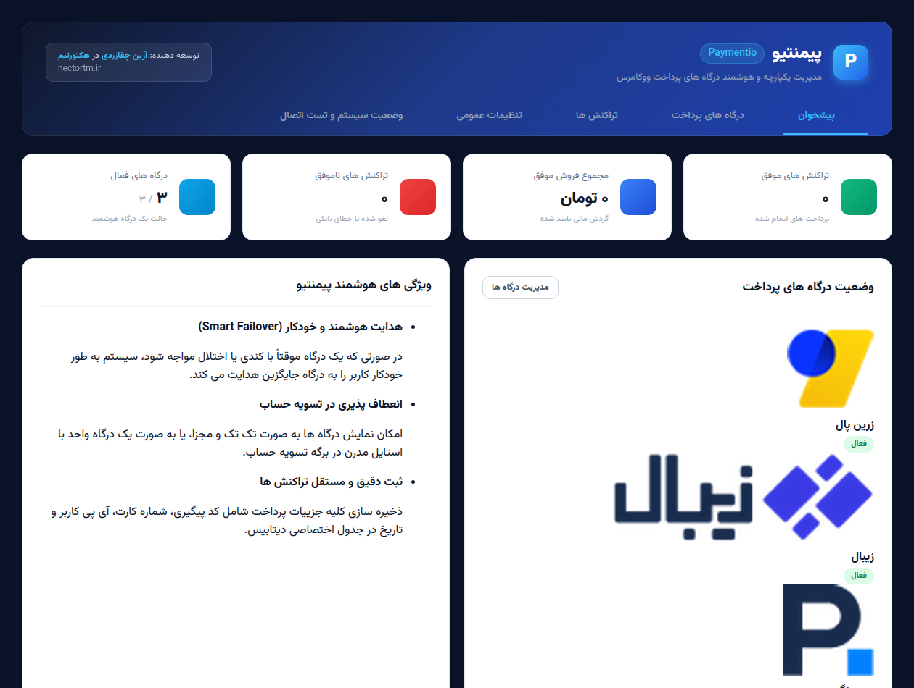
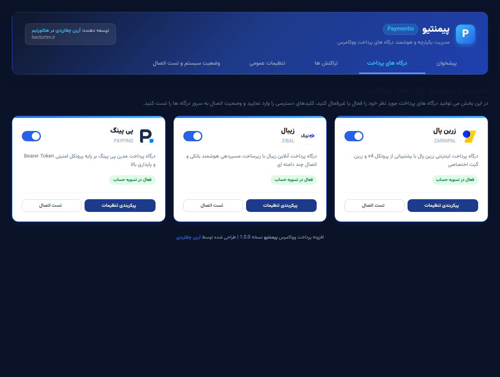
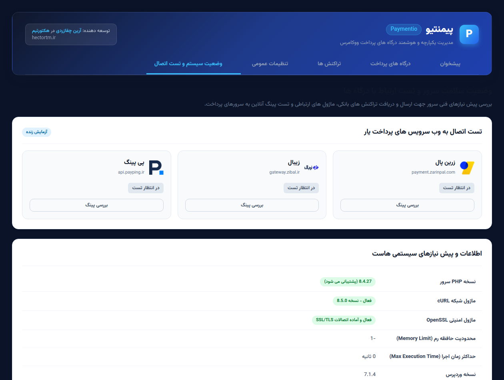
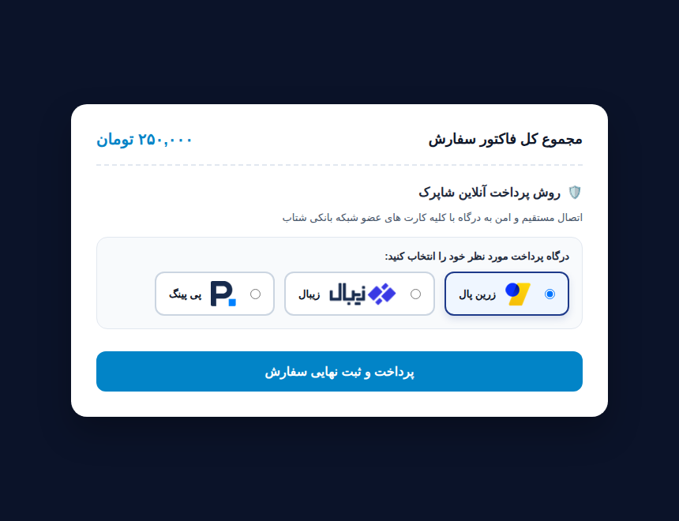

# پیمنتیو | Paymentio
### افزونه جامع، ماژولار و مدرن درگاه های پرداخت ووکامرس

<div align="center">

[](https://github.com/ArianChaghazardi/paymentio/releases/latest)
[](https://wordpress.org)
[](https://woocommerce.com)
[](https://php.net)
[](LICENSE)

<br/>

**توسعه داده شده توسط آرین چقازردی در تیم نرم افزاری هکتورتیم (HectorTM)**

[وبسایت هکتورتیم](https://hectortm.ir) • [کانال تلگرام هکتورتیم](https://t.me/HectorTM) • [وبسایت آرین چقازردی](https://arianchaghazardi.ir) • [دانلود آخرین نسخه](https://github.com/ArianChaghazardi/paymentio/releases/latest)

</div>

---

## فهرست مطالب

- [درباره پیمنتیو](#درباره-پیمنتیو)
- [تصاویر و پیش نمایش محیط افزونه](#تصاویر-و-پیش-نمایش-محیط-افزونه)
- [ویژگی ها و امکانات کلیدی](#ویژگی-ها-و-امکانات-کلیدی)
- [درگاه های پرداخت پشتیبانی شده](#درگاه-های-پرداخت-پشتیبانی-شده)
- [معماری فنی و ساختار پروژه](#معماری-فنی-و-ساختار-پروژه)
- [پیش نیازها](#پیش-نیازها)
- [راهنمای نصب و راه اندازی](#راهنمای-نصب-و-راه-اندازی)
- [تنظیمات و پیکربندی درگاه ها](#تنظیمات-و-پیکربندی-درگاه-ها)
- [راهنمای عیب یابی و سوالات متداول](#راهنمای-عیب-یابی-و-سوالات-متداول)
- [اطلاعات سازنده، تیم و شبکه های اجتماعی](#اطلاعات-سازنده-تیم-و-شبکه-های-اجتماعی)
- [مجوز و کپی رایت](#مجوز-و-کپی-رایت)

---

## درباره پیمنتیو

**پیمنتیو (Paymentio)** یک پکیج یکپارچه، سبک، امن و فوق العاده سریع برای مدیریت درگاه های پرداخت ووکامرس است. در وردپرس معمولاً مدیران سایت ها برای اتصال به هر درگاه پرداخت یار یا بانک مجبور به نصب یک افزونه سنگین، قدیمی یا غیر استاندارد هستند که سبب کندی سایت، تداخل کدهای جاوا اسکریپت و به خطر افتادن امنیت تراکنش ها می شود.

پیمنتیو با هدف پایان دادن به این پراکندگی، بر پایه معماری ماژولار شیءگرا (OOP)، استانداردهای رسمی وردپرس و رابط کاربری مدرن طراحی شده است. این افزونه با پشتیبانی همزمان از درگاه های محبوب نظیر **زرین پال، زیبال و پی پینگ** و با بهره گیری از سیستم هوشمند هدایت خودکار (Failover) و نمایش درگاه یکپارچه، ضامن پایداری ۱۰۰ درصدی پرداخت های فروشگاه شماست.

---

## تصاویر و پیش نمایش محیط افزونه

### ۱. پیشخوان مدیریتی پیمنتیو
نمای کلی آمار فروش، وضعیت درگاه ها و خلاصه تراکنش های اخیر در یک داشبورد مدرن سرمه ای (Dark Blue UI):



---

### ۲. مدیریت و پیکربندی درگاه های پرداخت
تنظیم آسان مرچنت کدها، حالت سندباکس، زرین گیت و اولویت بندی هوشمند درگاه ها:



---

### ۳. وضعیت سلامت سیستم و تست زنده اتصال (Health & Latency Check)
سنجش زنده تاخیر وب سرویس ها، بررسی اکستنشن های امنیتی سرور و نمایش آی پی خروجی هاست جهت ثبت در وایت لیست پرداخت یارها:



---

### ۴. درگاه یکپارچه و هوشمند در تسویه حساب (Unified Checkout)
تجربه کاربری منحصر به فرد با انتخاب گرافیکی درگاه توسط مشتری و ذخیره هوشمند انتخاب ها:



---

## ویژگی ها و امکانات کلیدی

- **طراحی مدرن و کاملاً واکنش گرا (Dark Blue Theme):**
  - استایل اختصاصی و بدون تداخل با سایر بخش های پیشخوان وردپرس.
  - همراه با فونت استاندارد و بومی **وزیر متن (Vazirmatn)** به صورت کاملاً لوکال و بدون نیاز به اینترنت خارجی یا CDN.
- **سیستم هدایت یکپارچه هوشمند (Smart Unified Gateway):**
  - امکان فعال سازی حالت «تک درگاه هوشمند» به جای شلوغ کردن فرم تسویه حساب با نام های مختلف.
  - نمایش کارت های شکیل گرافیکی با لوگوی باکیفیت هر درگاه و انتخاب آسان توسط خریدار.
- **سوئیچ خودکار درگاه در صورت قطعی (Smart Failover):**
  - در صورت بروز اختلال مقطعی در وب سرویس یا شبکه شاپرک یک درگاه، پرداخت به صورت اتوماتیک و بی وقفه به درگاه فعال بعدی منتقل می شود تا هیچ سفارشی معلق نماند.
- **پشتیبانی کامل از تمامی واحدهای پولی ایران:**
  - پشتیبانی هوشمند از ارزهای **تومان، ریال و هزار تومان**.
  - تبدیل خودکار مبالغ به کوچک ترین واحد مورد نیاز شاپرک پیش از ارسال درخواست پرداخت.
- **جدول مستقل تاریخچه و ثبت لاگ تراکنش ها:**
  - ایجاد جدول اختصاصی در دیتابیس وردپرس جهت ثبت دقیق شماره سفارش، کد رهگیری بانکی (RefID)، شماره کارت خریدار، شماره تماس، آدرس آی پی و وضعیت پرداخت.
- **بررسی زنده پینگ و نمایش آی پی واقعی هاست:**
  - ابزار داخلی پایش سلامت سرور که آی پی خروجی واقعی سرور را تشخیص داده و نمایش می دهد تا بدون دردسر در وایت لیست درگاه هایی مانند زیبال ثبت شود.

---

## درگاه های پرداخت پشتیبانی شده

### ۱. زرین پال (Zarinpal)
- پیاده سازی بر بستر آخرین نسخه **REST API v4**.
- مجهز به **صفحه واسط انتقال امن (Intermediate Auto-Submit Redirect)** با متای اختصاصی `Referrer-Policy: unsafe-url` جهت تضمین ارسال هدر ارجاع دامنه به شاپرک و برطرف سازی کامل خطای «دسترسی از این دامنه مجاز نمی باشد».
- پشتیبانی از اتصال مستقیم شاپرک (**ZarinGate**).
- اعتبارسنجی منعطف پارامترهای بازگشتی Callback بدون حساسیت به حروف بزرگ و کوچک (`Authority` و `authority`).

### ۲. زیبال (Zibal)
- سیستم مسیردهی پایدار و خودکار به سرورهای پشتیبان در صورت بروز اختلال در سرور اصلی.
- نقشه برداری جامع کدهای خطا از جمله تمایز دقیق بین خطای ۱۰۲ (مرچنت نامعتبر) و خطای ۱۱۵ (آی پی سرور در وایت لیست قرار ندارد).
- تست زنده ارتباط با وب سرویس زیبال از درون پیشخوان وردپرس.

### ۳. پی پینگ (PayPing)
- احراز هویت با ساختار مدرن استاندارد **Bearer Token**.
- پشتیبانی از نسخه ۳ وب سرویس پی پینگ و دریافت شناسه یکتای پرداخت (`paymentCode`).
- خواندن مستقیم داده های بازگشتی از جریان ورودی داده ها به صورت JSON استاندارد.
- اعتبارسنجی و پالایش خودکار شماره موبایل خریدار با انواع فرمت های 09xx و +98.

---

## معماری فنی و ساختار پروژه

کدنویسی افزونه به شیوه کاملاً ماژولار و مبتنی بر کلاس پایه `Paymentio_Gateway_Base` انجام گرفته است:

```text
paymentio/
├── assets/
│   ├── css/
│   │   ├── admin.css          # استایل های پیشخوان با تم سرمه ای مدرن
│   │   └── checkout.css       # استایل کارت های درگاه یکپارچه در تسویه حساب
│   ├── fonts/                 # فونت های بومی وزیرمتن (woff2)
│   ├── images/                # آیکون ها، لوگو و تصاویر اسکرین شات
│   │   └── screenshots/       # تصاویر بخش های مختلف افزونه
│   └── js/
│       ├── admin.js           # مدیریت رخدادهای پیشخوان و تست ایجکس
│       └── checkout.js        # تعامل انتخاب درگاه و ذخیره در سشن
├── includes/
│   ├── admin/
│   │   ├── class-paymentio-admin.php  # کنترلر منوها و اکشن های مدیریت
│   │   └── views/                     # قالب های پیشخوان، درگاه ها، تراکنش ها و سلامت
│   ├── gateways/
│   │   ├── class-gateway-unified.php  # منطق درگاه یکپارچه و هوشمند
│   │   ├── class-gateway-zarinpal.php # درگاه زرین پال v4
│   │   ├── class-gateway-zibal.php    # درگاه زیبال
│   │   └── class-gateway-payping.php  # درگاه پی پینگ v3
│   ├── class-paymentio-gateway-base.php # کلاس والد و مجرد درگاه ها
│   ├── class-paymentio-helper.php       # توابع کمکی تبدیل مبالغ، ارز و آی پی
│   ├── class-paymentio-db.php           # ساخت جدول تراکنش ها و عملیات دیتابیس
│   └── class-paymentio.php              # هسته هماهنگ کننده افزونه
├── paymentio.php              # فایل اصلی لودر افزونه وردپرس
└── README.md                  # مستندات کامل پروژه
```

---

## پیش نیازها

- وردپرس نسخه **۵.۶** یا بالاتر
- فروشگاه ساز ووکامرس نسخه **۴.۰** یا بالاتر (سازگار با نسخه ۱۱.۲)
- پی اچ پی نسخه **۷.۴** تا **۸.۴**
- فعال بودن اکستنشن های **cURL** و **OpenSSL** و **JSON** روی وب سرور

---

## راهنمای نصب و راه اندازی

### روش ۱: نصب از طریق فایل فشرده ریلیز (پیشنهادی)
1. به صفحه [ریلیزهای گیت هاب پیمنتیو](https://github.com/ArianChaghazardi/paymentio/releases/latest) بروید.
2. فایل `paymentio-v1.0.0.zip` را دانلود کنید.
3. در پیشخوان وردپرس، به مسیر **افزونه ها > افزودن افزونه > بارگذاری افزونه** بروید.
4. فایل زیپ را انتخاب و دکمه **نصب و فعال سازی** را کلیک نمایید.

### روش ۲: نصب از طریق گیت (برای توسعه دهندگان)
```bash
cd wp-content/plugins/
git clone https://github.com/ArianChaghazardi/paymentio.git paymentio
```

---

## تنظیمات و پیکربندی درگاه ها

1. پس از فعال سازی افزونه، از منوی پیشخوان وردپرس وارد منوی جدید **پیمنتیو** شوید.
2. روی تب **درگاه های پرداخت** کلیک کنید.
3. مرچنت کد (Merchant ID) یا توکن اختصاصی هر درگاه را در فیلد مربوطه وارد کرده و وضعیت آن را فعال کنید.
4. در صورت تمایل به استفاده از یک درگاه به عنوان درگاه پیش فرض یا استفاده از حالت تک درگاهی، وارد بخش **تنظیمات عمومی** شده و حالت نمایش تسویه حساب را روی گزینه مورد نظر تنظیم کنید.
5. به بخش **وضعیت سیستم و تست اتصال** مراجعه کرده و با کلیک روی دکمه تست اتصال هر درگاه، از صحت ارتباط وب سرور خود با سرورهای شاپرک اطمینان حاصل فرمایید.

---

## راهنمای عیب یابی و سوالات متداول

### خطای «دسترسی از این دامنه مجاز نمی باشد» در زرین پال:
این خطا زمانی رخ می دهد که مرورگر هدر `Referer` را به سمت زرین پال ارسال نکند یا دامنه درخواست دهنده با دامنه ثبت شده در پنل زرین پال مطابقت نداشته باشد. پیمنتیو با صفحه ریدایرکت اختصاصی و اعمال متای `unsafe-url` این هدر را به صورت استاندارد پاس می دهد. همچنین دقت کنید دامنه ثبت شده در پنل زرین پال با دامنه فعال سایت یکی باشد.

### خطای ۱۱۵ در درگاه زیبال:
این خطا به این معناست که آی پی خروجی سرور شما در پنل زیبال وایت لیست نشده است. برای رفع آن، وارد تب **وضعیت سیستم** در پیشخوان پیمنتیو شوید، آی پی سرور نمایش داده شده را کپی کرده و در پنل کاربری زیبال در بخش تایید آی پی سرور وارد فرمایید.

### خطای احراز هویت در پی پینگ:
توکن دریافتی از پنل پی پینگ باید به صورت دقیق و بدون کاراکترهای فاصله اضافی در بخش تنظیمات درگاه وارد شود.

---

## اطلاعات سازنده، تیم و شبکه های اجتماعی

این افزونه با افتخار توسط **آرین چقازردی** در **هکتورتیم (HectorTM)** توسعه داده شده و به صورت متن باز و رایگان در دسترس جامعه توسعه دهندگان وب فارسی قرار گرفته است.

<div align="center">

### هکتورتیم | HectorTM
تیم تخصصی طراحی وبسایت، سئو و توسعه سیستم های نرم افزاری نوین

🌐 **وبسایت رسمی:** [hectortm.ir](https://hectortm.ir)  
📢 **کانال تلگرام:** [@HectorTM](https://t.me/HectorTM)

---

### آرین چقازردی | Arian Chaghazardi
توسعه دهنده وب و نرم افزار

🌐 **وبسایت شخصی:** [arianchaghazardi.ir](https://arianchaghazardi.ir)  
💻 **گیت هاب:** [github.com/ArianChaghazardi](https://github.com/ArianChaghazardi)  
✈️ **تلگرام:** [@ArianChaghazardi](https://t.me/ArianChaghazardi)  
🐦 **توییتر / X:** [@ArianChaghazard](https://x.com/ArianChaghazard)  
📧 **ایمیل ارتباطی:** arianchaghazardi@gmail.com

</div>

---

## مشارکت در توسعه

از ایده ها، پیشنهادات و پول ریکوئست های شما عزیزان برای بهبود افزونه و افزودن درگاه های مستقیم بانکی جدید (مانند به پرداخت ملت، سداد ملی، سامان کیش، پارسیان و ...) با کمال میل استقبال می شود.

---

## مجوز و کپی رایت

کلیه حقوق مادی و معنوی این اثر متعلق به **آرین چقازردی** و **هکتورتیم (HectorTM)** می باشد. استفاده، شخصی سازی و توسعه این پروژه تحت پروانه نرم افزاری معتبر آزاد است.
